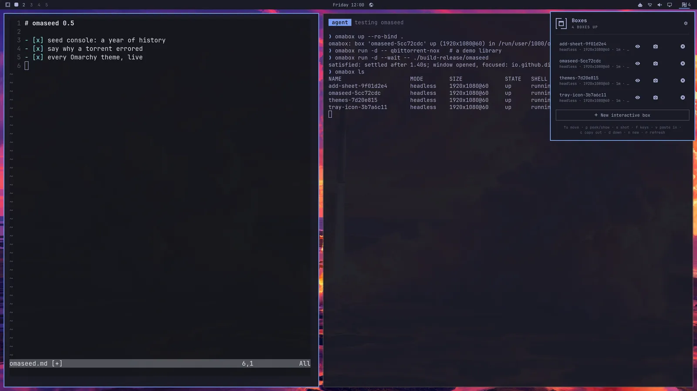
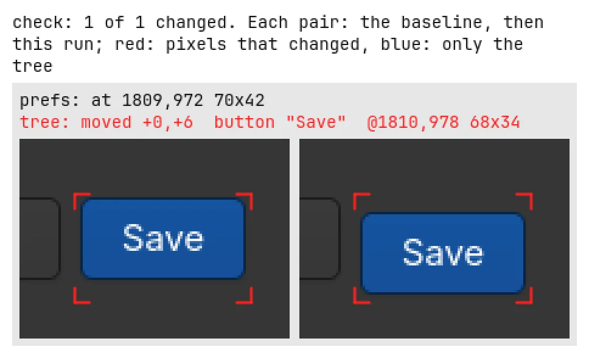
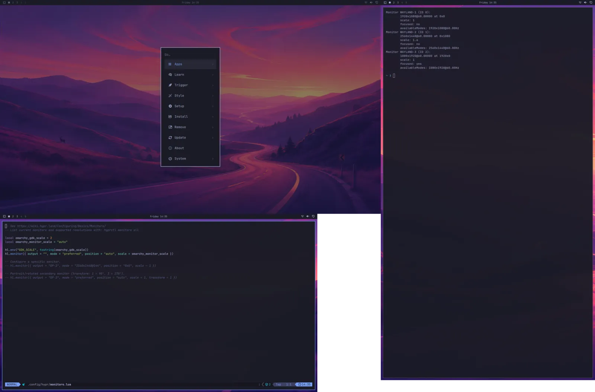
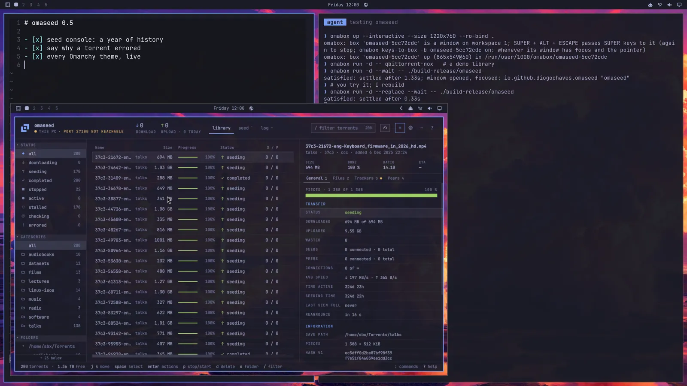

<h1>
  <picture>
    <source media="(prefers-color-scheme: dark)" srcset="assets/omabox-lockup-dark.svg">
    
  </picture>
</h1>

**Your agents get desktops of their own. Yours stays untouched.** omabox gives every AI agent a
whole Hyprland desktop with the Omarchy shell, hidden and in parallel, to launch, click, type and
screenshot apps and shell plugins in. No windows popping up on your screen, no cursor jumps, no
stolen focus, no notifications or tray icons left behind.

I made it while building [omaseed](https://omaseed.app): my agent kept testing it on my desktop,
popping windows up as I typed, moving my cursor, typing into its app. So I gave it a desktop of its
own, and a month and 32 releases later it is 1.0, with more uses than the one it started with.

<!-- TODO(#401): the 1.0 video, as a user-attachments link from Diogo's upload of renders/1.0-post.mp4 -->

<p></p>

Four agents, four boxes, each testing an app. On your desktop, only the agent's `omabox ls` and the
bar widget say so.

**[omabox.app](https://omabox.app)** has the rest: [what agents use boxes for](https://omabox.app/uses),
[testing your app](https://omabox.app/develop) (visual checks, several monitors, videos, a Hyprland
or Omarchy change), [Omarchy in a box](https://omabox.app/omarchy) (your bar, your theme, shell
plugins), [how it works](https://omabox.app/how-it-works) and [every command](https://omabox.app/commands).

omabox keeps an agent's apps off your desktop; it is not a sandbox. To fence the agent itself in,
pair it with [ai-jail](#related-projects).

## Install

You need **Omarchy 4** (Hyprland 0.56+) and a GPU render node: AMD and Intel iGPUs and NVIDIA RTX
cards are tested.

```bash
git clone https://github.com/diogochaves/omabox && cd omabox
./install.sh                            # packages (sudo only if some are missing), omabox, links
./install.sh --check                    # the same, then start a box, screenshot it, tear it down
```

`install.sh` builds omabox (Rust) and a private copy of aquamarine with the fixes boxes need (your
system's is not touched), links `~/.local/bin/omabox`, the agent skill for Claude Code, Codex,
OpenCode, pi and Hermes, and the bar widget, then asks whether to put the widget in your bar and to
turn on the [agent guard](#the-agent-guard). **Update** with `git pull && ./install.sh`, and after a
Hyprland upgrade too. Upgrading from 0.x, removing it, and what each step does:
[omabox.app/install](https://omabox.app/install).

## Using it

Your agents drive boxes themselves, through the skill. These are the commands you will reach for:

```bash
omabox up                                 # a hidden desktop for this repo, ready in a few seconds
omabox run -- ctest --test-dir build      # desktop-touching tests in a throwaway box
omabox shot                               # a screenshot of the box; prints the PNG's path
omabox check run -- ./visual.sh           # a visual pass: "same", or what moved and by how much
omabox peek                               # watch a box live, in a view-only window on workspace 9
```

`omabox up --interactive` opens a box as a window you drive yourself, `omabox down` ends one, and
the bar widget lists every box with Peek, Screenshot and Down. Clicking, typing, reading an app as
text, recording a video and the rest: `omabox help`, or [omabox.app/commands](https://omabox.app/commands).

<p></p>

`omabox peek` on each of those four boxes: live, view only, on a workspace of your choosing.

<p></p>

`omabox check run` after a change: the report names the button that moved, and by how much.

<p></p>

One box, three monitors you may not have: a 1440p at scale 1.6 and a portrait one.

<p></p>

`omabox up --interactive`: a box you drive yourself, while the agent rebuilds the app in it.

## Agents

The skill sends agents to a box when a task involves a GUI app, a screenshot, a shell plugin or
tests that touch the desktop. Projects need no changes: when a project's own instructions say "run
the app", "screenshot with grim" or "run ctest", the agent does exactly that in a box. To make it a
rule rather than the agent's judgement, add a line to your agent's global instructions:

> Never launch, screenshot or drive GUI apps on my desktop, and never run tests that touch the desktop
> session there. Use omabox (see the omabox skill).

### The agent guard

The skill is advice. The guard (opt-in; Claude Code and Codex, or any agent through `guard exec`)
makes a slip fail instead: agents' shells get a display that does not exist, so a stray window,
`hyprctl`, `grim` or `omarchy-theme-set` fails with an error the skill explains, and a link an agent
opens is refused instead of landing in your browser.

```bash
omabox guard on               # every installed agent; omabox guard off takes it out again
omabox host -- CMD            # from a guarded shell: one command on your real desktop, when you asked for it
omabox guard exec -- AGENT    # any other agent: start it under the guard
```

It stops accidents, not an agent that sets the variables back on purpose, processes the agent starts
outside its shell (a headed browser MCP opens on your desktop), writes to the files your shell
watches (`~/.config/omarchy/shell.json`, `plugins/`), or anything over the session bus
(notifications, the keyring, `uwsm-app`, `systemd-run --user`). For a fence, run the agent in a
sandbox that blocks Unix sockets, or in [ai-jail](#related-projects). `omabox guard` says what it
sets for each agent.

## What a box can and cannot touch

- **Your files**: the repo you run `omabox up` from, **read-only** at the same path (from a git
  worktree or submodule, its git dir in the main checkout's `.git` too, so git works there; inside
  ai-jail, a worktree's when the jail has that `.git` as a folder of its own, as `ai-jail --worktree`
  maps it), plus the dirs
  in `~/.config/omabox/ro-bind` (one per line) or `--ro-bind`; mise's toolchains (so `omabox run`
  finds node, python, uv as on the host), the `--plugin` and `--theme-dir` dirs, your fonts
  (`~/.local/share/fonts`, `~/.fonts`, at the same place in the box HOME; not in a `--clean` box,
  `--no-seed fonts` leaves them out) and your git `user.name` and `user.email`. Nothing else of your
  HOME. Refused whatever you pass: anything that
  is or contains HOME, `~/.config/omarchy` or `/tmp`, anything inside `~/.config/omarchy` but
  `plugins/` and `themes/` (`api-keys.env`, your hooks), the secret stores (`~/.ssh`, `~/.gnupg`, keyrings,
  `~/.password-store`, `~/.aws`, `~/.kube`, `~/.docker`, `~/.netrc`, `~/.git-credentials`, gh's,
  gcloud's, azure's and 1Password's `op` config; the coding agents' own, `~/.claude`, `~/.codex`, OpenCode's,
  pi's, Hermes' and Gemini's; the browsers' profiles, `~/.mozilla`, Chromium's, Chrome's, Brave's, Vivaldi's,
  Edge's, and `~/.pki`), omabox's own saves and box HOMEs
  (`~/.local/share/omabox`, `~/.cache/omabox`), your runtime dir, `/run`, `/dev`, `/proc`, `/sys`.
- **Its HOME** is fake, seeded with your theme and shell settings and nothing secret (no API keys,
  keyrings or tokens), and `omabox down` deletes it with whatever a plugin or app changed there.
- **Its session**: a private session bus, its own accessibility (AT-SPI) bus and a throwaway keyring
  (secrets stored and read without prompts), no system bus, no real input devices, no audio unless `--audio` (then its own PipeWire, a
  speaker nobody hears and a silent mic; never your audio server or `/dev/snd`), no Xwayland unless `--xwayland`.
  `/usr`, `/etc` and `/sys` are read-only, with no `sudo`, pacman or polkit, so nothing in a box can
  install packages, system config or rules. Your host's processes are not visible from it.
- **Your seat**: a box never gets `/dev/dri/card*`, `/dev/input`, seatd, the system bus or your real
  `$XDG_RUNTIME_DIR`: that is what keeps its Hyprland off your real screens. An interactive box
  holds one already-open connection to your compositor, never its socket, so nothing inside can open
  windows on your desktop. Keys go the other way: what you type into its window, the box reads.
- **The network**: every box has one of its own. By default (`--net connected`) it reaches the
  internet, your LAN and your host's servers, and you reach its servers on your `127.0.0.1`; with
  `--net isolated` it has only a loopback and the host ports you `--allow` (`omabox up --net
  isolated --allow 8081,8082`). Ports on `omabox config protect-ports` stay out of reach of every
  box. What reaches outside (API calls, uploads, changes to a server) is real, and `down` does not
  undo it.
- **Not a security boundary**: a box shares your kernel and GPU (a runaway app can load or hang it)
  and, by default, your network. Commands you run on the host, a project's `sudo ./setup` or
  `omabox host -- CMD`, are not boxed. For code you do not trust, use `--net isolated` at least,
  [ai-jail](#related-projects), or a VM. [SECURITY.md](SECURITY.md) lists each rule that keeps a box
  off your desktop, where it is enforced and the test that proves it.

Some things still need your real machine: your real data and services, desktop integration outside a
session (.desktop files, URL handlers, autostart; systemd user units only in a `--systemd` box, and
never with journald or logind), real monitors (their modes, HDR, VRR, a real hotplug), idle and
suspend, a real password at the lock screen, and final release acceptance.

## Stability

omabox is used mostly by agents, which read its warnings; a script or CI reads `--json` and exit
codes, and watches stderr for `deprecated:`. From 1.0, within 1.x:

- **Kept, or changed only by addition:** exit codes (0 done or yes, 1 failed or no, 2 called wrongly,
  124 not in time; `check run`'s 3 and 4; `run`'s 125 for its own failures, its command's status
  otherwise: `omabox help exit-codes`), and `--json`'s field names, types and meaning (fields may be
  added: read the ones you need by name; `skill/reference.md`, "JSON", lists them).
- **Changed only after a warning:** commands (`brief` and the aliases help documents among them),
  options, arguments, `config` keys and `OMABOX_*` variables. The new form comes first; the old one
  keeps working for one minor release, with `omabox: deprecated: OLD: write NEW` on stderr and a
  CHANGELOG line under "Deprecated"; then it is refused with a line naming the new one, never read
  another way. `OMABOX_STRICT=1` refuses it at once (exit 2), for CI.
- A save made by a 1.x starts with any later 1.x (`up --from`). A `check` baseline approved by a 1.x
  compares with any later 1.x, or is refused ("approve again"), never compared wrongly. [What a box
  cannot touch](#what-a-box-can-and-cannot-touch) only gets stricter.

Not covered: the wording of messages and tables; help and skill text; defaults and heuristics (each
change gets a CHANGELOG line, and no timeout gets shorter in 1.x); the pixels of the images omabox
draws; what other programs report through omabox, as they report it (`hyprctl`, `lua`, Hyprland's
own fields in `windows --json`, `events`, `tree`'s roles); a box's inside (its HOME, config and
logs); and internal or undocumented forms, such as a box's name given to `peek`, `reload` or
`restart-shell` without `-b`.

## Related projects

omabox does one thing: keep agents off your desktop while they test on a desktop of their own.
These projects are good at what it does not do.

- **[ai-jail](https://github.com/akitaonrails/ai-jail)** ([aijail.io](https://aijail.io)), by Fabio
  Akita, fences the agent in: bubblewrap, Landlock and seccomp on Linux, `sandbox-exec` on macOS, so
  your home, keys and cloud credentials are out of reach. ai-jail answers what the agent can touch,
  omabox where it draws, and they stack: an agent inside ai-jail drives boxes of its own through
  omabox's broker (`omabox broker on` prints the lines to add to `~/.ai-jail`), and only the boxes
  that jail started, with no more network or files than the jail has. Tested with ai-jail 2.10.0
  and 2.12.0 and omabox 1.0 on Linux, and before that with ai-jail 2.2.1, 2.6.2 and 2.8.1.
- **[omarchy-in-omarchy](https://github.com/jankeesvw/omarchy-in-omarchy)** is a disposable Omarchy
  in QEMU/KVM: for what needs a whole machine, an installer or an `omarchy-update` migration, system
  services, suspend, a reboot. Boxes while developing, a VM before a release.
- **[Cua](https://github.com/trycua/cua)** ([cua.ai](https://cua.ai)) is for the opposite: agents
  that use your own desktop and apps, across macOS, Windows, Linux and Android.

The longer comparison is on [omabox.app/compare](https://omabox.app/compare).

## Thanks

To [Tyler South](https://github.com/btsouth), whose nine PRs in omabox's first week (NVIDIA support,
a box for each agent session, a network for each box, and more) 1.0 still rests on, and who found
and fixed the guard's leftover backups on his own upgrade to 1.0 (1.0.1). To
[overp0werj0int](https://github.com/overp0werj0int) for the fix for Qt 6.12. And to Fabio Akita
for ai-jail.

## Contributing

Contributions are welcome, and so are people trying it on other NVIDIA models, other GPUs,
multi-monitor desks, or a fresh Omarchy install. Bug reports, fixes, tests and ideas all help;
[CONTRIBUTING.md](CONTRIBUTING.md) says how, and what a report needs. What changed in each version:
[CHANGELOG.md](CHANGELOG.md). What omabox carries until upstream releases land: [UPSTREAM.md](UPSTREAM.md).

## License

MIT: see [LICENSE](LICENSE).

<sub>omabox is an independent community project, not affiliated with or endorsed by Omarchy.</sub>
