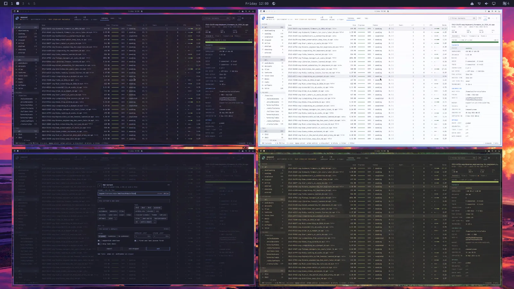

# Seeing a box yourself

Peek, interactive boxes, the clipboard, the bar widget and its settings. Back to the
[README](../README.md).

- **`omabox peek -b NAME`**: a live, view-only window of any box on workspace 9, opened without
  focus. It only copies frames out, so the agent never notices, and closes with SUPER+W or when the
  box goes down. For a few seconds it shows what the agent does: a ring where it points and clicks,
  and the keys it types (a `--pass` password as `*`), never in the box's own screen or screenshots.
- **`omabox up --interactive`**: the box is a real window on workspace 9 that you drive with your
  own keyboard and mouse. **SUPER+ALT+ESCAPE** sends SUPER keys to the box instead of your desktop,
  once; **`omabox keys-to-box -b NAME on`** (or the keyboard button in the widget) sends them
  whenever the box's window has focus and the pointer is over it. While they go to a box, its border turns the theme's red and
  the widget's icon lights up. The box follows the window's size; closing the window ends it.
- **`omabox clip`**: your clipboard's item (text, or an image by its type) into an interactive box,
  once; `clip --from-box` hands the box's back. With no `-b` it is the box whose window has focus
  (else the only interactive one), so a key binding pastes into the box you are in. None is
  installed; for SUPER+ALT+V, add to `~/.config/hypr/bindings.lua`:
  `o.bind("SUPER + ALT + V", "Clipboard into the box", "omabox clip")` (not while
  SUPER keys go to the box: after SUPER+ALT+ESCAPE, or with keys-to-box on and the box focused). Nothing keeps watching either clipboard. It is
  never for agents: refused in their sessions, under the agent guard and in ai-jail (headless boxes
  are refused too). A password manager's "sensitive" mark goes along, so clipboard histories leave
  the secret out; what you hand to a box can still be read there by whatever runs in it, an agent
  driving that box included.
- **The bar widget** (`chaves.omabox`): the omabox mark in your bar lists every box, with **Peek**
  (or **Show**, for an interactive one), **Screenshot** and **Down**, **Paste your clipboard into the
  box** and **Copy the box's clipboard out** on an interactive one, and **New interactive box**.
  For a rail that hosts bar widgets it also exposes `consoleAwake` (true while a box is up) and
  `consoleState` (`running` then), the rail's convention for a module's state.

## Settings, and the widget's keys

Settings live in `~/.config/omabox/config`: `omabox config` lists them, the widget's gear changes
them, and `omabox config KEY default` puts one back.

- `workspace WS`: where interactive and peek windows open, always without focus. The default is 9;
  per box: `up --interactive --workspace WS`, `peek --workspace WS`.
  - `1`-`99`: a workspace. Omarchy 4.5 gives each monitor ten of its own; a number is the first
    monitor's.
  - `special:omabox` (the widget's **Its own**): a special workspace of omabox's. A window there is
    full size, the widget's **Show** opens it over the workspace you are on, and switching workspace
    hides it; a box keeps drawing while hidden. To toggle it with a key, add a line like this one to
    `~/.config/hypr/bindings.lua` (SUPER+ALT+B is only an example, free in Omarchy 4.5's defaults):
    `o.bind("SUPER + ALT + B", "Box windows", hl.dsp.workspace.toggle_special("omabox"))`.
  - `special:NAME`: another special workspace (bind a key to it yourself).
  - `special`: Omarchy's scratchpad (SUPER+S shows and hides it). On Omarchy 4.5 it is the Quake
    console: a half-height panel that starts the default agent when it opens empty, so a lone box
    window there is boxed into it; `omabox` says so when it is set.

  On a workspace in floating mode (Omarchy 4.5: SUPER+L cycles to it), a box's window floats with a
  titlebar, like any window there.
- `confirm-close on`: closing an interactive box's window asks first. The box opens a new window
  where you are, with Omarchy's menu ("Shut down" / "Keep it running"); closing that window too is a
  yes. It applies to running boxes as well. Per box: `--confirm-close` or `--no-confirm-close` on
  `up`. It needs aquamarine's fix (`omabox setup --aquamarine`): without it, boxes leave it off and
  the bar widget greys its switch out.
- `bar-icon`: `always` (the default) keeps the widget's icon in the bar with no box up, dimmed, so
  its settings are a click away; `auto` shows it only while boxes exist.
- `gpu`: the GPU headless boxes render on: `auto` (the default: the first usable
  render node), `nvidia`, `amd`, `intel` (or a driver's name: `amdgpu`, `i915`, ...), or a PCI slot
  (`0000:01:00.0`: for two GPUs of one kind). `omabox config gpu` lists the GPUs with the values that
  name each, and marks the one in use. When that GPU is not there (an NVIDIA card handed to a VM), `up`
  renders on the first one and says so, and why (`bound to vfio-pci`).
  `OMABOX_RENDER_NODE=/dev/dri/renderDN` overrides it. Interactive boxes render on your desktop's
  GPU whatever it says. `auto` stays the default: on a laptop the iGPU saves battery. The widget's
  Settings has it as a picker on a machine with more than one GPU (a GPU bound to `vfio-pci` is listed,
  unavailable, and why). `omabox ls` and `omabox gpu` show each box's GPU, and **`omabox gpu release
  GPU`** takes down the headless boxes on one (naming each, after any `up` in progress) before you hand
  it to a VM: a box holds its render node.
- `shot-fit N`: every `shot` comes out as with `--fit N` (its longest side scaled down to N pixels)
  unless it is given a `--fit`, for an agent on a model that reads click points in the smaller image
  its API scales a big one down to (`1456` for a 16:9 screen on Claude; NOTES finding 251). It goes
  where `--fit` goes (window shots, `-g`, `--monitor`, `--burst`, `drag --shot`), not `--changed` or
  `--zoom`; `click --in` maps it as usual, and `--fit 0` takes one shot full size. `off` (the
  default) clears it; `OMABOX_SHOT_FIT=N` (or `off`) overrides it for one agent. Which N, for the
  model at hand: have the agent run `omabox calibrate` (it reads a test card and says the size).
- `protect-ports 8080,5432`: host ports no connected box reaches (a database, your own app's dev
  server), on the host's loopback or any of its other addresses; an isolated box's `--allow` refuses
  them. None by default; `default` removes them. Needs `nft` (nftables) when set. A value that is not
  a list of ports stops every `up` until it is fixed.
  Tested on a desktop with an AMD iGPU and an NVIDIA dGPU (on `nvidia` and on `vfio-pci`); laptops
  (hybrid graphics, MUX, eGPU) should work the same but are untested: reports welcome (#119).

Passthrough (SUPER+ALT+ESCAPE) turns itself off when focus leaves the box, or on the first key you
press with the pointer outside it. With **keys-to-box** on (per box, off by default, until the box
goes down) focus and the pointer decide, with no key to press: while the box's window has focus and
the pointer is over it, SUPER is the box's; move the pointer off it (onto your bar, an empty part of
the workspace, another monitor) or focus elsewhere, and SUPER is yours again, keys-to-box still on;
the pointer back over the box, SUPER is the box's again. The first key you press with the pointer
off the box is already yours (SUPER+1 switches your workspace at once). `omabox keys-to-box -b NAME`
says whether it is on, `on`/`off` changes it, and `omabox ls` shows it. SUPER+ALT+ESCAPE over the
box gives the keys back until the box loses focus and gets it again. Either way, while keys go to a
box its window's border takes the theme's red (the colour the bar uses for what calls for
attention) and the widget's icon is lit in it.

The widget's panel shows each box's mode, size, age, plugins, whether it is being peeked at and
where its keys go, and a count in the bar when there are several. Keys: arrows or j/k, Enter or `p`
peek/show, `s` shot, `v` paste your clipboard in and `c` copy the box's out, `f` keys-to-box on or off
(these three on an interactive box), `d` down (twice within 3 s, the second at least 0.4 s after the
first, so a double-click is not a confirmation; Enter on a dead box arms it), `n` new (twice, the
same way), `r` refresh. **New interactive box** starts one under a free name (`omabox up --interactive --new`:
box-1, box-2, ...) and brings its window forward. Every row has its buttons in the same places, an
empty slot where an action does not apply, so a click from habit never lands on another action. While
the pointer is over the panel the list holds still: a box that goes stays greyed, marked gone, and a
new one is counted in the header (`1 NEW`) until the pointer leaves. A list taller than the screen
scrolls, the New button and the keys staying in view. If `omabox ls` fails, the panel says so. The
widget only displays `omabox ls --json` and runs `omabox`; the CLI owns every rule.
